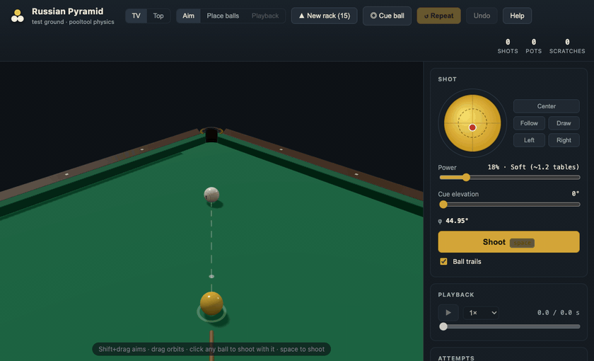
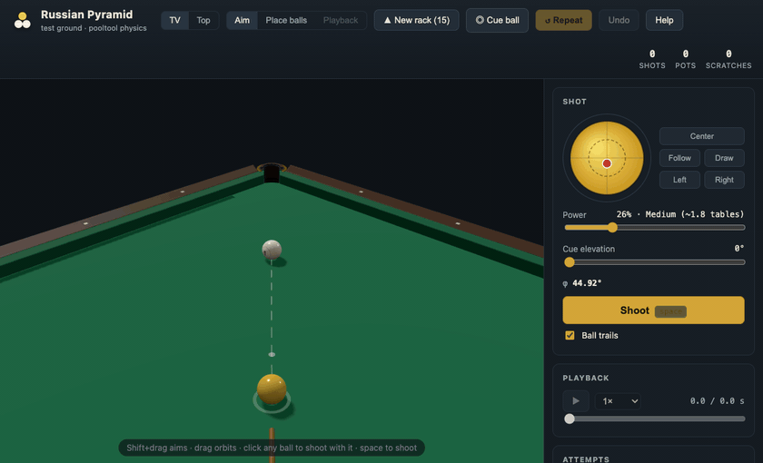
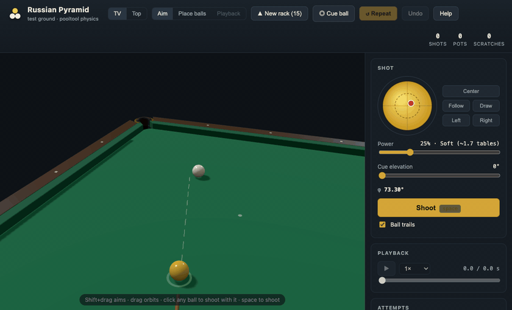
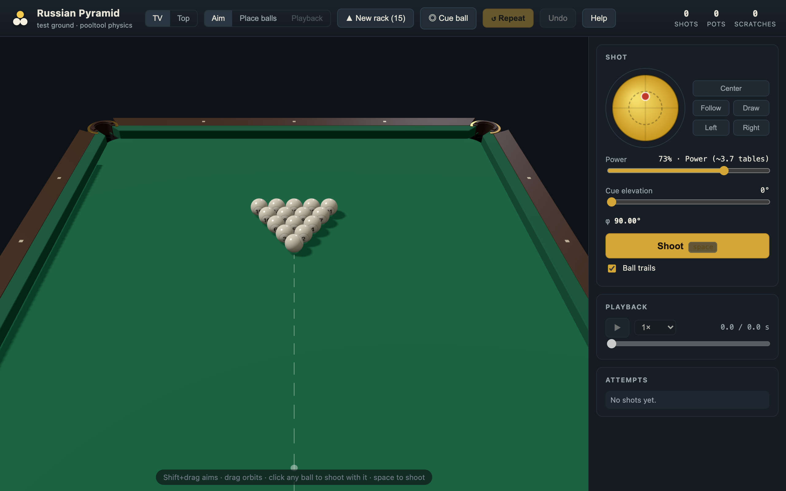
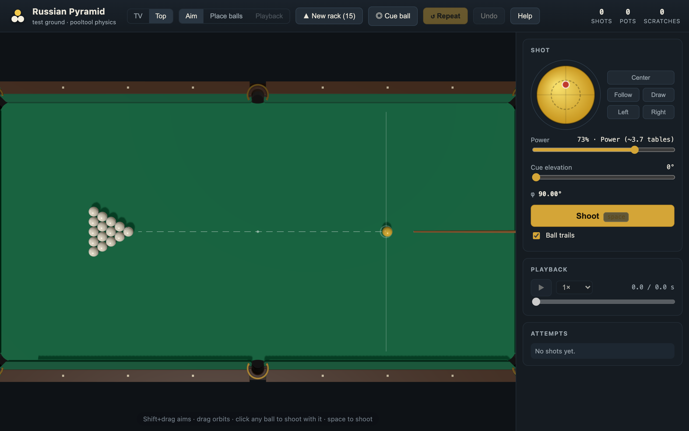
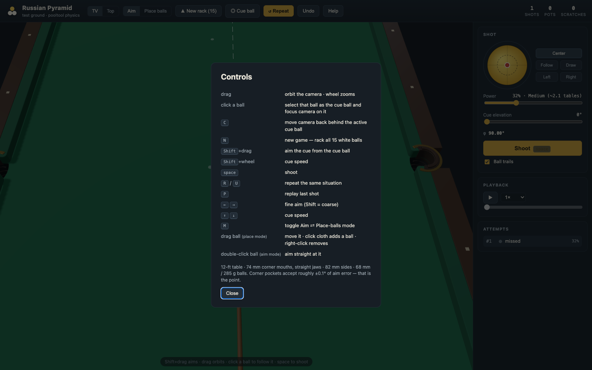

# Russian Pyramid — 3D Practice Table

A 3D visual training ground and physics workbench for **Russian Pyramid** (*Русский бильярд*), built to **train your eye on how to play billiards**.

Russian Pyramid is notorious for its unforgiving equipment: **68 mm (285 g) balls** played into **72.5 mm corner pockets** with straight jaws. Along the corner bisector, the pocket accepts barely **±0.1° of directional error**. Developing a reliable eye for cut angles, off-center cue alignment, spin-induced throw, and cue-ball carom trajectories (*svoyaks* / *свояки*) requires seeing the same geometry over and over until the sight picture clicks.

> **Scope & Philosophy:** This project is **not** meant to cover every extreme trick shot, jump shot, or exotic edge case, nor is it a full match game with rules or AI opponents. Instead, it accurately models **the vast majority of practical, real-world shots** you actually face at the table — giving you a fast, distraction-free **aim → shoot → replay → repeat** loop to calibrate your vision and stroke parameters.

---

## Shot Demonstrations

### 1. Pocket Acceptance — Jaw Bounce & Drop

*A soft-paced shot (`V0 = 1.3 m/s`) into the top-right corner pocket just off the bisector: the ball rattles between the leather jaws, loses energy, and drops in. ([Watch MP4](assets/jaw_bounce_pot.mp4))*

<br/>

### 2. Pocket Rejection — Jaw Rattle & Spit-Out

*The same corner setup struck firmer (`V0 = 1.8 m/s`, `0.08°` off the bisector): the tight straight jaws reject the pace, rattling the ball three times before spitting it back onto the table. ([Watch MP4](assets/jaw_bounce_reject.mp4))*

<br/>

### 3. Svoyak (Свояк — Cue-Ball Carom into Pocket)

*The signature Russian Pyramid shot: with the cue shifted parallel off-center (`a = 0.15, b = 0.10`), the yellow cue ball clips object ball `#1` and caroms cleanly into the top-right corner pocket. ([Watch MP4](assets/svoyak_pot.mp4))*

---

## Workbench & Table Views

### 3D Practice Workbench & Off-Center Sighting

*Interactive 3D view: moving the tip contact point on the spin pad shifts the cue stick and its collinear dashed aiming line in parallel across the cue ball, matching how you line up side spin in real life.*

<br/>

### Full 15-Ball Pyramid Rack

*Standard 15-ball pyramid rack on the foot spot ready for break and cluster practice.*

<br/>

### Top-Down Table & Pocket Geometry

*Regulation 3.56 × 1.78 m (12-ft) playing surface, head string, spots, and tight corner/side pocket geometry.*

<br/>

### In-Game Controls & Keybindings

*Built-in controls reference accessible anytime by pressing <kbd>?</kbd> or clicking Help.*

---

## Key Features

- **Eye-Training Sighting & Cue Geometry**:
  - **Parallel Off-Center Cue Shift**: Adjusting horizontal/vertical spin (`a`, `b`) on the spin pad translates the 3D cue stick in parallel across the cue ball's face.
  - **Collinear Sightline**: The dashed aiming line stays strictly collinear with the cue shaft so you see where the cue tip is actually pointing, while the physics engine accounts for off-center squirt, swerve, and collision throw.
  - **Animated Cue Stroke**: Smooth pullback, acceleration, and follow-through on both live shots and replays.
  - **Direct Target Aiming (`Shift + Click / Drag`)**: Hold <kbd>Shift</kbd> and click (or drag) where you want to hit on the target ball or cloth — the cue's sightline snaps immediately to that target point, matching how you pick a contact point in real life.
- **Free-Roaming 3D Camera System**:
  - Drag to orbit; scroll wheel to zoom.
  - **Explore Untethered**: Walk freely around the entire 12-ft table using <kbd>W</kbd><kbd>A</kbd><kbd>S</kbd><kbd>D</kbd> (<kbd>Q</kbd>/<kbd>E</kbd> for height) or pan across the cloth with **Right-drag** / <kbd>⌘</kbd>+**Drag** to inspect pocket jaws and contact points up close without being tied to a ball.
  - Click any ball to shoot with it, or press <kbd>C</kbd> anytime to return right behind your active cue ball.
  - One-click presets: **TV angle** (over the shoulder of the active ball) and **Top-down** view.
- **Authentic 12-ft Tournament Geometry**:
  - 3.56 × 1.78 m playing surface.
  - 72.5 mm corner pocket mouths with rounded leather jaw horns and 45° straight jaws.
  - 82 mm side pockets with splayed jaws.
  - Recessed pocket wells, leather hoods (*пелерины*), brass brackets (*скобы*), and cloth markings.
- **Event-Based Physics** via [`pooltool-billiards`](https://pooltool.readthedocs.io):
  - 68 mm / 285 g tournament balls.
  - Sliding, rolling, and spinning transitions on cloth.
  - Follow, draw, side english, elevated-cue swerve/massé, and cut-induced throw.
  - True jaw rattle, lip bounce, and pocket drop trajectories.
- **Dedicated Practice & Playback Modes**:
  - **Aim Mode**: Configure spin, power, and cue elevation, then shoot (<kbd>Space</kbd>).
  - **Playback Mode**: Click any logged attempt, press <kbd>P</kbd>, or use the playback controls to enter persistent **Playback** mode. The Shot panel locks and displays the exact parameters of that attempt while you scrub through time or adjust playback speed (`0.25×` – `2×`).
  - **Repeat Situation (<kbd>R</kbd> / <kbd>U</kbd>)**: Instantly restore the pre-shot ball layout. Clicking **↺ Repeat** while inspecting an attempt in Playback mode restores the table *and* loads that attempt's exact spin, power, and angle so you can tweak it from there.
  - **Place Balls Mode (<kbd>M</kbd>)**: Drag balls anywhere on the cloth, click empty cloth to add balls, or right-click a ball to remove it.

---

## Quickstart

```bash
make setup    # Set up Python virtual environment and dependencies
make start    # Launch the practice room at http://127.0.0.1:8765
```

---

### Alternative Installation Options

#### Using `uv` (Recommended)

```bash
uv tool install git+https://github.com/t10ko/russian-pyramid
russian-pyramid
```

#### Using `pipx`

```bash
pipx install git+https://github.com/t10ko/russian-pyramid
russian-pyramid
```

#### From Source

```bash
git clone git@github.com:t10ko/russian-pyramid.git
cd russian-pyramid
make setup
make start
```

#### macOS App Bundle

You can also build a native standalone `.app`:

```bash
packaging/build_macos.sh
```

---

## Controls & Keybindings

| Input | Action |
| :--- | :--- |
| **Drag** | Orbit camera around current view point |
| <kbd>W</kbd><kbd>A</kbd><kbd>S</kbd><kbd>D</kbd> / **Right-Drag** (<kbd>⌘</kbd>+**Drag**) | Move freely around the table without being tied to a ball (<kbd>Q</kbd>/<kbd>E</kbd> height) |
| **Scroll Wheel** | Zoom camera in / out |
| **Click ball** | Follow that ball and make it the active cue ball |
| <kbd>C</kbd> | Move camera focus back behind the active cue ball |
| <kbd>Shift</kbd> + **Click / Drag** | Aim the cue immediately at the clicked/dragged target point |
| <kbd>Shift</kbd> + **Wheel** | Adjust cue striking speed (power) |
| <kbd>Space</kbd> | Shoot (or skip to end of current shot animation) |
| <kbd>R</kbd> / <kbd>U</kbd> | Repeat the pre-shot situation (adopts replayed attempt's aim if in Playback mode) |
| <kbd>P</kbd> | Enter Playback mode and replay the selected / last shot |
| <kbd>←</kbd> <kbd>→</kbd> | Fine aim adjustment (±0.05°, with <kbd>Shift</kbd> = ±0.5°) |
| <kbd>↑</kbd> <kbd>↓</kbd> | Adjust cue power |
| <kbd>N</kbd> | New rack (15 white balls racked on the foot spot) |
| <kbd>M</kbd> | Toggle Aim ⇄ Place balls mode (or exit Playback back to Aim) |
| **Drag ball** *(Place mode)* | Move ball position on table |
| **Click cloth** *(Place mode)* | Add a new ball |
| **Right-click ball** *(Place mode)* | Remove ball |
| **Double-click ball** *(Aim mode)* | Aim straight at that ball |
| <kbd>?</kbd> | Open help & controls overlay |

---

## Physics & Table Specification

Physics simulations are computed server-side using [pooltool](https://github.com/ekiefl/pooltool) with parameters tailored to Russian Pyramid standards in [`src/russian_pyramid/config.py`](src/russian_pyramid/config.py):

| Parameter | Value | Details |
| :--- | :--- | :--- |
| **Table Surface** | 3.56 × 1.78 m | 12-ft tournament standard |
| **Corner Mouth** | 72.5 mm | Barely ~4.5 mm total clearance for a 68 mm ball |
| **Corner Jaws** | 45° straight, 10 mm horn radius | Rounded leather jaw horns (*губки луз*) |
| **Side Mouth** | 82 mm | Tight side pocket entry with splayed jaws |
| **Ball** | 68 mm, 285 g | Aramith Tournament Pyramid specification |
| **Cloth Sliding Friction** | `u_s = 0.20` | High-grade worsted tournament cloth |
| **Cloth Rolling Friction** | `u_r = 0.01` | Fast rolling cloth |
| **Ball-to-Ball Restitution** | `e_b = 0.95` | High-elasticity phenolic resin |
| **Ball-to-Ball Friction** | `u_b = 0.05` | Generates realistic cut-induced throw |

Presets:
- `--physics tournament` (default): Fast rail response standard in competitive pyramid.
- `--physics research`: Cushion damping matching heavier leather faces.

---

## Development

All standard workflows are available via `make`:

```bash
make setup     # Create virtualenv and install editable package + dev dependencies
make start     # Run the application (or pass ARGS="--drill rack --no-browser")
make test      # Run full pytest suite and headless UI smoke tests
make smoke     # Run headless canvas UI smoke tests in Node.js
make lint      # Check code formatting with ruff
make format    # Automatically format code with ruff
make clean     # Clean build artifacts and pycache
make help      # Show all available make targets
```

### Repository Structure

```
├── Makefile                    # Developer targets (make start, make setup, etc.)
├── assets/                     # Recorded shot GIFs/MP4s, screenshots, and social previews
├── packaging/                  # PyInstaller spec and macOS app builder
├── scripts/                    # Setup script, headless smoke test, and asset tools
│   ├── setup.sh                # Environment preparation script
│   └── ui_smoke.mjs            # Headless UI smoke test
├── src/
│   └── russian_pyramid/
│       ├── cli.py              # CLI entry point (arg parsing, server startup)
│       ├── config.py           # Table dimensions, ball specs, physics presets
│       ├── drills.py           # Built-in practice layouts (rack, straight, cuts, svoyak)
│       ├── physics.py          # Pooltool physics solver integration
│       ├── server.py           # Lightweight HTTP server & JSON API
│       ├── session.py          # State tracking, undo/repeat, attempt history
│       └── static/             # Frontend UI (3D Three.js view, CSS, aim & playback controls)
└── tests/                      # Pytest suite (physics, drills, session, API)
```

---

## License

[MIT License](LICENSE). Built with [pooltool](https://github.com/ekiefl/pooltool) and [three.js](https://threejs.org).
