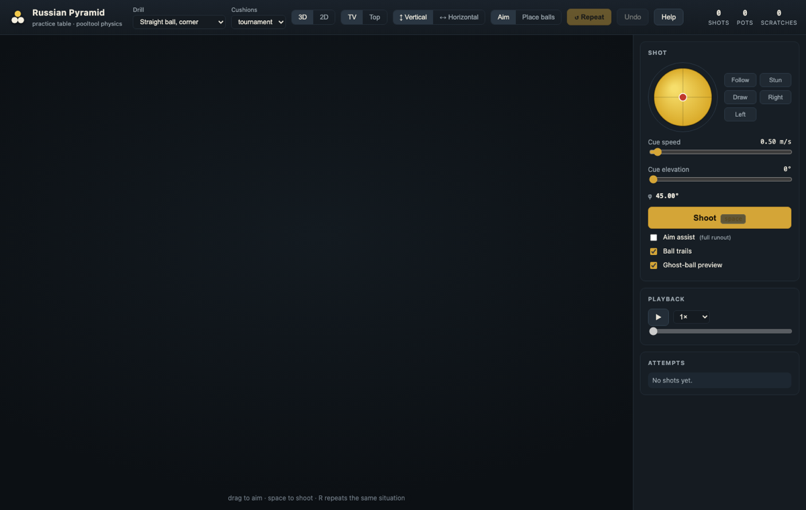

# Russian Pyramid — Practice Table

A repetition-focused **Russian Pyramid** trainer: a 12-foot table with true
pooltool physics, an aim/spin/power workbench, shot replay with trails, and a
one-key **"repeat the same situation"** so you can drill a ball until you own
it.

Not a game — a practice room.



## What's in the box

- **3D view (default)** — a real perspective table you can orbit (drag) and
  zoom (wheel), with a TV camera behind the head rail; toggle to a precise
  top-down **2D view** (<kbd>V</kbd>), shown vertically like the real table
  (horizontal layout also available).
- **12-ft Russian Pyramid table** — 3.56 × 1.78 m playing surface, 74 mm
  corner mouths with straight jaws and sharp 1.5 mm horns, 82 mm side pockets.
  The rendered cushion noses, jaw arcs, and pocket circles are *the exact
  collision geometry* the solver uses.
- **68 mm / 285 g balls** simulated by [pooltool](https://pooltool.readthedocs.io)
  (event-based physics: sliding/rolling/spinning regimes, throw, jaw friction,
  follow/draw/english, elevated-cue massé).
- **Brutal, honest pockets** — a corner accepts roughly ±0.1° of aim error
  along the bisector. Dead-center drops; a whisker off rattles in the jaws.
  Potted balls visibly roll into the hole and drop below the cloth.
- **Practice loop** — shoot → watch the replay (trails, cushion ripples, pot
  animations) → press <kbd>R</kbd> and the *exact* pre-shot situation returns.
  Attempt history tracks every try with its parameters and outcome.
- **Aim tools** — ghost-ball preview, cue-stick rendering with spin dot,
  optional *aim assist* that runs the full simulated runout, fine aim in
  0.05° steps.
- **Drills** — free practice, full-rack break, straight/cut corner balls,
  side pockets, and a svoyak (cue-ball carom) drill.
- **Cushion presets** — `tournament` (fast rails) or `research` (the heavily
  deadened leather-jaw values; see *Physics notes*).

## Install (macOS)

### Easy way — uv (recommended)

```bash
uv tool install git+https://github.com/tigranatayan/russian-pyramid
russian-pyramid
```

Your browser opens `http://127.0.0.1:8765`. That's it.

### pipx

```bash
pipx install git+https://github.com/tigranatayan/russian-pyramid
russian-pyramid
```

### From source

```bash
git clone https://github.com/tigranatayan/russian-pyramid
cd russian-pyramid
uv venv && uv pip install -e .      # or: python3 -m venv .venv && .venv/bin/pip install -e .
.venv/bin/russian-pyramid
```

### Mac app bundle

Grab `Russian Pyramid.dmg` from [Releases](../../releases), drag to
/Applications, open. (The app is unsigned — right-click → *Open* the first
time.) To build it yourself: `packaging/build_macos.sh`.

Requires Python 3.10–3.13 on macOS (arm64 and x86_64). The underlying
`pooltool-billiards` package brings its own numba/Rust-accelerated physics.

## Controls

| Input | Action |
| --- | --- |
| drag on table | aim from the cue ball (works in 3D via cloth picking) |
| drag in 3D | orbit the camera; wheel zooms |
| <kbd>space</kbd> | shoot |
| <kbd>R</kbd> / <kbd>U</kbd> | repeat the same situation |
| <kbd>P</kbd> | replay last shot |
| <kbd>V</kbd> | toggle 3D / 2D view |
| <kbd>←</kbd> <kbd>→</kbd> | fine aim (±0.05°, Shift = ±0.5°) |
| <kbd>↑</kbd> <kbd>↓</kbd> / wheel | cue speed |
| <kbd>M</kbd> | toggle Aim ⇄ Place-balls mode |
| <kbd>A</kbd> | aim assist (full runout) |
| drag ball *(place mode)* | move it; click cloth adds a ball; right-click removes |
| double-click ball *(aim mode)* | aim straight at it |

Spin is set with the pad (yellow ball with a red dot): up = follow, down =
draw, sides = english. Cue elevation enables massé-style shots.

## The practice loop

1. Pick a drill (or place your own balls in *Place balls* mode).
2. Aim, set spin and speed, shoot.
3. Watch the replay — trails show the paths, ripples mark cushion hits.
4. Press **Repeat**: the pre-shot layout returns instantly, attempt logged.
5. Change one variable at a time. Own the angle.

## Physics notes

All physics is [pooltool](https://github.com/ekiefl/pooltool) (v0.6,
event-based). The Russian Pyramid character comes from the configuration in
[`src/russian_pyramid/config.py`](src/russian_pyramid/config.py):

| Parameter | Value | Note |
| --- | --- | --- |
| Table | 3.56 × 1.78 m | 12-ft tournament spec |
| Corner mouth | 74 mm | ~1.5 mm slack per side for a 68 mm ball |
| Corner jaws | straight, 1.5 mm radius | sharp leather-over-brass horns |
| Side mouth | 82 mm | |
| Ball | 68 mm, 285 g | Aramith Tournament Pyramid |
| Cloth | u_s 0.20, u_r 0.01 | |
| Ball-ball | u_b 0.05, e_b 0.95 | cut-induced throw is real — compensate |

Two findings from validating the geometry (see
[`examples/pocket_rattle_test.py`](examples/pocket_rattle_test.py)):

- **Capture radius must exceed pocket depth.** pooltool pots a ball when its
  center passes within `corner_pocket_radius` of the pocket center, which sits
  exactly `corner_pocket_depth` beyond the corner. With the naive 42 mm / 45 mm
  pair the pocket is *geometrically un-pottable* — every ball bounces out.
- **Corner entries go along the bisector.** Aiming at the pocket *center*
  (which lies outside the rails) sends the object ball into the cushion face.
  The drills aim along the corner diagonal; that's also how you play a real
  pyramid pocket.

`e_c` (cushion restitution) and `f_c` (cushion friction) in pooltool apply to
**all** cushions — rails and jaws alike. The `research` preset uses the
deadened leather values (0.58 / 0.40); `tournament` (default) keeps the fast
rails pyramid is famous for.

## Development

```bash
uv venv && uv pip install -e ".[dev]"
uv run pytest                    # physics, drills, session, server tests
uv run ruff check src tests      # lint
node scripts/ui_smoke.mjs        # headless frontend run (see file header)
```

Layout:

```
src/russian_pyramid/
  config.py     # table, ball, cushion parameters (single source of truth)
  physics.py    # pooltool bridge: build, simulate, pack frames/events
  drills.py     # built-in practice layouts
  session.py    # situation snapshots, attempts, undo/repeat
  server.py     # stdlib HTTP server: static UI + JSON API
  cli.py        # `russian-pyramid` entry point
  static/       # canvas frontend (no build step)
packaging/      # PyInstaller spec + macOS build script
examples/       # pocket rattle experiment (headless pooltool demo)
```

The frontend is dependency-free ES modules (plus a vendored
[three.js](https://threejs.org) copy for the 3D view) talking to a small JSON
API (`server.py` docstring). Every shot is simulated server-side from a plain
`{ball_id: (x, y)}` layout, which is what makes undo/repeat trivial and exact.
`node scripts/ui_smoke.mjs` runs the real frontend headlessly against a
canvas-spec-checking stub.

## Roadmap

- [ ] Situation library: save/share layouts as JSON, import/export in UI
- [ ] randomize drill positions ("same drill, new lie")
- [ ] multi-shot sequences (break → run-out practice)
- [ ] Windows/Linux app bundles
- [ ] game rulesets (free pyramid / dynamic pyramid / Moscow) on top of the
      same loop

## License

[MIT](LICENSE). Physics by [pooltool](https://github.com/ekiefl/pooltool)
(also MIT-ish; see its repository).
