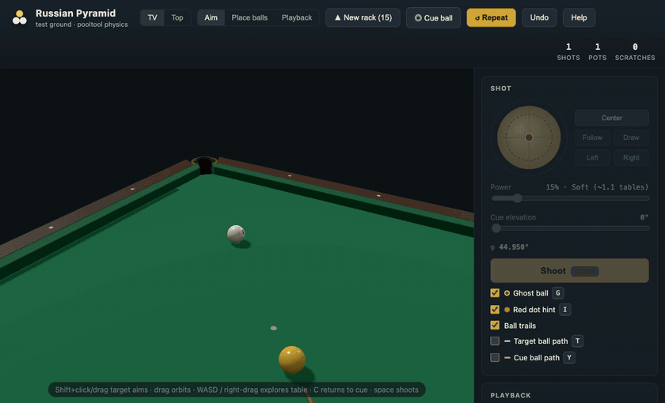
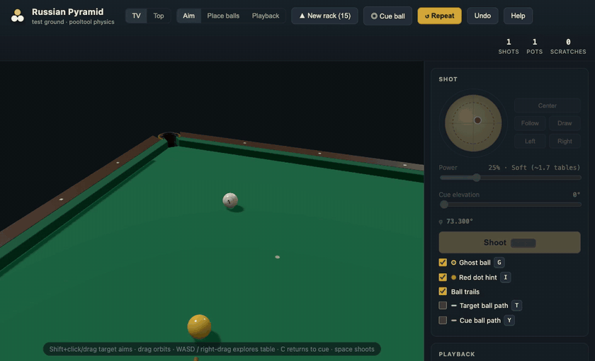
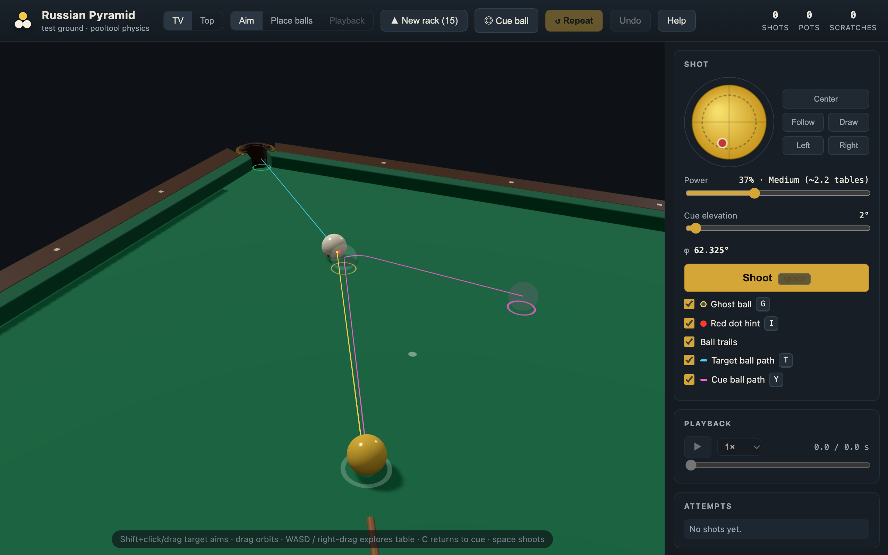
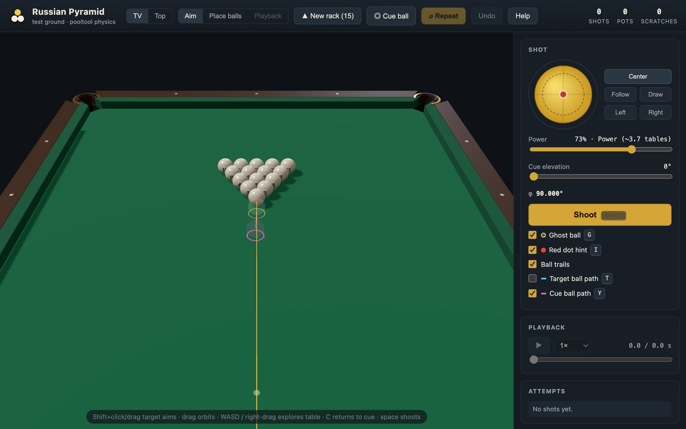
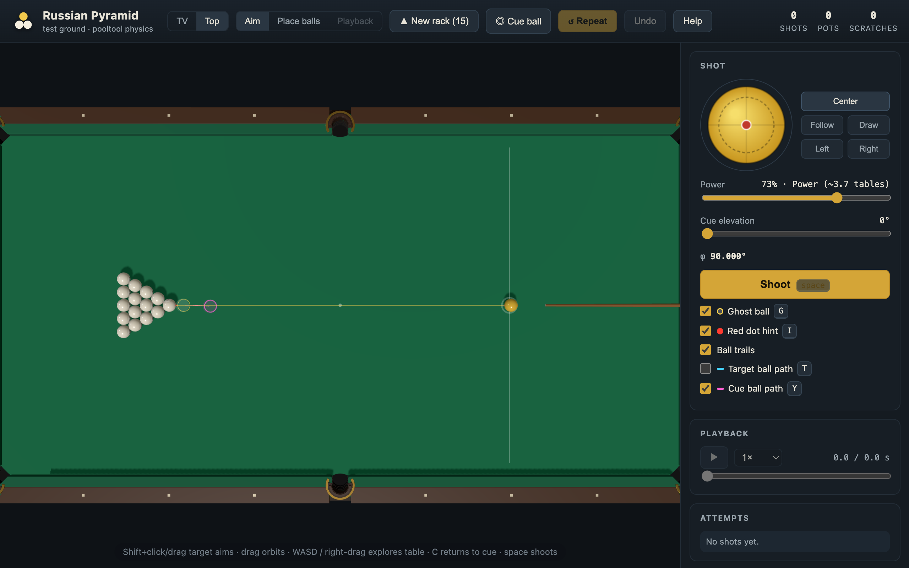
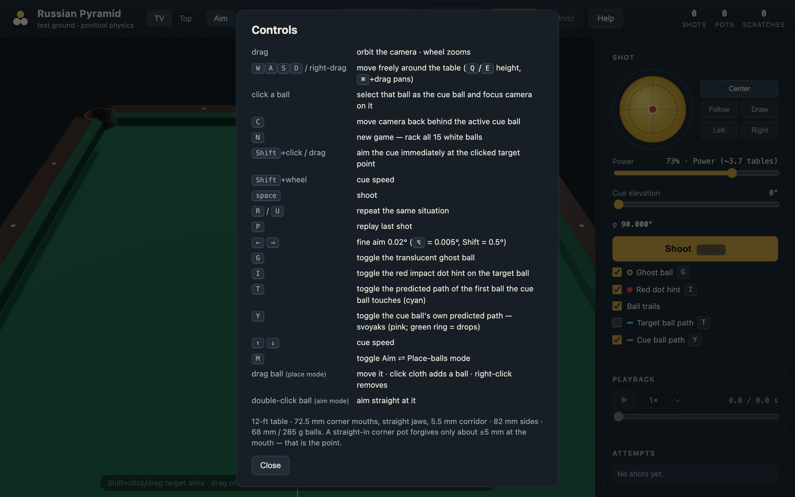

# Russian Pyramid — 3D Practice Table

A 3D visual training ground and physics workbench for **Russian Pyramid** (*Русский бильярд*), built to **train your eye on how to play billiards**.

Russian Pyramid is notorious for its unforgiving equipment: **68 mm (285 g) balls** played into **72.5 mm corner pockets** with straight jaws. A straight-in corner pot forgives only about **±5 mm** at the mouth — on a 1 m + 1 m shot that is roughly **±0.02° of cue direction**. Developing a reliable eye for cut angles, off-center cue alignment, spin-induced throw, and cue-ball carom trajectories (*svoyaks* / *свояки*) requires seeing the same geometry over and over until the sight picture clicks.

> **Scope & Philosophy:** This project is **not** meant to cover every extreme trick shot, jump shot, or exotic edge case, nor is it a full match game with rules or AI opponents. Instead, it accurately models **the vast majority of practical, real-world shots** you actually face at the table — giving you a fast, distraction-free **aim → shoot → replay → repeat** loop to calibrate your vision and stroke parameters.

---

## Shot Demonstrations

### 1. Pocket Acceptance — Jaw Bounce & Drop

*A soft-paced shot (`V0 = 1.1 m/s`, `0.05°` off the bisector) into the top-right corner pocket: the ball rattles between the leather jaws, loses energy, and drops in. ([Watch MP4](assets/jaw_bounce_pot.mp4))*

<br/>

### 2. Pocket Rejection — Jaw Rattle & Spit-Out

*The exact same `0.05°`-off corner setup struck firmer (`V0 = 1.8 m/s`): the tight straight jaws reject the pace, rattling the ball before spitting it back onto the table. ([Watch MP4](assets/jaw_bounce_reject.mp4))*

<br/>

### 3. Svoyak (Свояк — Cue-Ball Carom into Pocket)

*The signature Russian Pyramid shot: with the cue shifted parallel off-center (`a = 0.15, b = 0.10`), the yellow cue ball clips object ball `#1` and caroms cleanly into the top-right corner pocket. ([Watch MP4](assets/svoyak_pot.mp4))*

---

## Workbench & Table Views

### 3D Practice Workbench & Off-Center Sighting

*Interactive 3D view: moving the tip contact point on the spin pad (up to `0.72 R` for realistic pyramid draw and english) shifts the cue stick and its collinear aiming line in parallel across the cue ball, while showing both the **yellow aim dot** (where your sightline hits the target ball) and the **red impact dot** (where the balls physically touch).*

<br/>

### Full 15-Ball Pyramid Rack

*Standard 15-ball pyramid rack on the foot spot ready for break and cluster practice.*

<br/>

### Top-Down Table & Pocket Geometry

*Regulation 3.56 × 1.78 m (12-ft) playing surface, head string, spots, and tight corner/side pocket geometry.*

<br/>

### In-Game Controls & Keybindings

*Built-in controls reference accessible anytime by pressing <kbd>?</kbd> or clicking Help.*

---

## Key Features

- **Eye-Training Sighting & Cue Geometry**:
  - **Parallel Off-Center Cue Shift & Realistic Spin Zone**: Adjusting horizontal/vertical spin (`a`, `b`, up to `0.72 R` for authentic deep pyramid *оттяжка* / draw and english) translates the 3D cue stick in parallel across the cue ball's face.
  - **Dual Target-Ball Dots (Aim vs. Impact)**: Displays both a **yellow dot** where your cue's collinear sightline intersects the target ball and a **red dot** where the balls physically collide at impact — letting your eyes directly learn cut-angle and squirt offsets on the ball itself.
  - **Graduated Training Aids (`G` / `I` / `T` / `Y`)**: Toggle the translucent **Ghost ball** (<kbd>G</kbd>), **Red dot hint** (<kbd>I</kbd>), **Target ball path** (<kbd>T</kbd>, cyan), and **Cue ball path** (<kbd>Y</kbd>, pink) independently so you can strip away visual crutches step by step as your eye improves.
  - **Animated Stroke & Resting Follow-Through**: Smooth pullback, acceleration, and follow-through on both live shots and replays; after the stroke, the cue stays parked in its follow-through pose until you click the next ball you want to play (or press <kbd>C</kbd> / <kbd>R</kbd>), matching Free Pyramid (*Amerikanka*) table flow.
  - **Direct Target Aiming (`Shift + Click / Drag`)**: Hold <kbd>Shift</kbd> and click (or drag) where you want to aim on the target ball or cloth — the cue's sightline snaps immediately to that spot.
  - **Layout-Independent Shortcuts**: All keyboard shortcuts bind to physical key positions (`KeyboardEvent.code`), so hotkeys keep working seamlessly regardless of the active OS input language (English, Armenian, Russian, etc.).
- **Free-Roaming 3D Camera System**:
  - Drag to orbit; scroll wheel to zoom.
  - **Explore Untethered**: Walk freely around the entire 12-ft table using <kbd>W</kbd><kbd>A</kbd><kbd>S</kbd><kbd>D</kbd> (<kbd>Q</kbd>/<kbd>E</kbd> for height) or pan across the cloth with **Right-drag** / <kbd>⌘</kbd>+**Drag** to inspect pocket jaws and contact points up close without being tied to a ball.
  - Click any ball to shoot with it, or press <kbd>C</kbd> anytime to return right behind your active cue ball.
  - One-click presets: **TV angle** (over the shoulder of the active ball) and **Top-down** view.
- **Authentic 12-ft Tournament Geometry**:
  - 3.56 × 1.78 m playing surface.
  - 72.5 mm corner pocket mouths with rounded leather jaw horns and 45° straight jaws.
  - 82 mm side pockets with splayed jaws.
  - Recessed pocket wells, leather hoods (*пелерины*), brass brackets (*скобы*), and cloth markings.
- **Event-Based Physics** via [`pooltool-billiards`](https://pooltool.readthedocs.io):
  - 68 mm / 285 g tournament balls.
  - Sliding, rolling, and spinning transitions on cloth.
  - Follow, draw, side english, elevated-cue swerve/massé, and cut-induced throw.
  - True jaw rattle and lip bounce; regulation pocket fall lines (5.5 mm corner corridor, R1 = 5 mm / R2 = 11 mm noses).
  - Physical pot drop: the ball tips over the slate edge, falls under gravity, and hard pots slam into the back of the pocket before settling in the net.
- **Dedicated Practice & Playback Modes**:
  - **Aim Mode**: Configure spin, power, and cue elevation, then shoot (<kbd>Space</kbd>).
  - **Playback Mode**: Click any logged attempt, press <kbd>P</kbd>, or use the playback controls to enter persistent **Playback** mode. The Shot panel locks and displays the exact parameters of that attempt while you scrub through time or adjust playback speed (`0.25×` – `2×`).
  - **Repeat Situation (<kbd>R</kbd> / <kbd>U</kbd>)**: Instantly restore the pre-shot ball layout. Clicking **↺ Repeat** while inspecting an attempt in Playback mode restores the table *and* loads that attempt's exact spin, power, and angle so you can tweak it from there.
  - **Place Balls Mode (<kbd>M</kbd>)**: Drag balls anywhere on the cloth, click empty cloth to add balls, or right-click a ball to remove it.

---

## Install on macOS

### Option 1: Homebrew Cask *(Recommended — skips Gatekeeper prompt)*

```bash
brew tap t10ko/tap && brew trust t10ko/tap
brew install --cask t10ko/tap/russian-pyramid
```

Installs **Russian Pyramid.app** into `/Applications`, links the `russian-pyramid` CLI into your `PATH`, and strips macOS quarantine automatically via [`t10ko/homebrew-tap`](https://github.com/t10ko/homebrew-tap). Upgrade anytime with `brew upgrade --cask russian-pyramid`.

### Option 2: Direct `.dmg` Download

1. Open the [latest GitHub release](https://github.com/t10ko/russian-pyramid/releases/latest) and download the disk image for your Mac:
   - **Apple Silicon** (M-series chip) — `russian-pyramid-arm64.dmg`
   - **Intel** — `russian-pyramid-x86_64.dmg`
2. Open the disk image and drag **Russian Pyramid** into **Applications**.
3. Launch **Russian Pyramid** from Applications or Spotlight. The practice table runs in its own window and works offline.

The disk images are distributed without Apple notarization. If macOS Gatekeeper blocks a browser-downloaded `.dmg` on first launch, either strip the quarantine attribute once:

```bash
xattr -dr com.apple.quarantine "/Applications/Russian Pyramid.app"
```

or use the **Open Anyway** button in *System Settings → Privacy & Security* ([Apple’s guide](https://support.apple.com/en-us/102445)). Building and installing locally via `make install-app` also bypasses browser quarantine altogether.

## Quickstart from source

```bash
make setup    # Set up Python virtual environment and dependencies
make start    # Launch the practice room at http://127.0.0.1:8765
```

---

### Alternative Installation Options

#### Using `uv` (Recommended)

```bash
uv tool install git+https://github.com/t10ko/russian-pyramid
russian-pyramid
```

#### Using `pipx`

```bash
pipx install git+https://github.com/t10ko/russian-pyramid
russian-pyramid
```

#### From Source

```bash
git clone git@github.com:t10ko/russian-pyramid.git
cd russian-pyramid
make setup
make start
```

#### macOS App Bundle

Build **Russian Pyramid.app** on macOS with `uv` and the Xcode command line tools, or install/update `/Applications/Russian Pyramid.app` directly in one command:

```bash
make install-app          # Build and update /Applications/Russian Pyramid.app (quarantine-free)
# or build app + distributable DMG manually:
packaging/build_macos.sh
packaging/package_macos.sh
```

The built app and disk image are saved in `packaging/dist`.

---

## Controls & Keybindings

| Input | Action |
| :--- | :--- |
| **Drag** | Orbit camera around current view point |
| <kbd>W</kbd><kbd>A</kbd><kbd>S</kbd><kbd>D</kbd> / **Right-Drag** (<kbd>⌘</kbd>+**Drag**) | Move freely around the table without being tied to a ball (<kbd>Q</kbd>/<kbd>E</kbd> height) |
| **Scroll Wheel** | Zoom camera in / out |
| **Click ball** | Select that ball as the active cue ball and focus camera on it |
| <kbd>C</kbd> | Move camera focus back behind the active cue ball |
| <kbd>Shift</kbd> + **Click / Drag** | Aim the cue immediately at the clicked/dragged target point |
| <kbd>Shift</kbd> + **Wheel** | Adjust cue striking speed (power) |
| <kbd>Space</kbd> | Shoot (or skip to end of current shot animation) |
| <kbd>R</kbd> / <kbd>U</kbd> | Repeat the pre-shot situation (adopts replayed attempt's aim if in Playback mode) |
| <kbd>P</kbd> | Enter Playback mode and replay the selected / last shot |
| <kbd>←</kbd> <kbd>→</kbd> | Fine aim adjustment (±0.02°, <kbd>⌥</kbd> = ±0.005°, <kbd>Shift</kbd> = ±0.5°) |
| <kbd>↑</kbd> <kbd>↓</kbd> | Adjust cue power |
| <kbd>G</kbd> | Toggle the translucent ghost ball |
| <kbd>I</kbd> | Toggle the red impact dot hint on the target ball |
| <kbd>T</kbd> | Toggle predicted path of the first ball the cue ball touches (cyan) |
| <kbd>Y</kbd> | Toggle the cue ball's own predicted path — svoyaks (pink; green ring = drops) |
| <kbd>N</kbd> | New rack (15 white balls racked on the foot spot) |
| <kbd>M</kbd> | Toggle Aim ⇄ Place balls mode (or exit Playback back to Aim) |
| **Drag ball** *(Place mode)* | Move ball position on table |
| **Click cloth** *(Place mode)* | Add a new ball |
| **Right-click ball** *(Place mode)* | Remove ball |
| **Double-click ball** *(Aim mode)* | Aim straight at that ball |
| <kbd>?</kbd> | Open help & controls overlay |

---

## Physics & Table Specification

Physics simulations are computed server-side using [pooltool](https://github.com/ekiefl/pooltool) with parameters tailored to Russian Pyramid standards in [`src/russian_pyramid/config.py`](src/russian_pyramid/config.py):

| Parameter | Value | Details |
| :--- | :--- | :--- |
| **Table Surface** | 3.56 × 1.78 m | 12-ft tournament standard |
| **Corner Mouth** | 72.5 mm | Barely ~4.5 mm total clearance for a 68 mm ball |
| **Corner Jaws** | 45° straight, R1 = 5 mm noses, 5.5 mm corridor | Regulation rounded rubber noses (*губки луз*) & short corridor |
| **Side Mouth** | 82 mm, R2 = 11 mm noses | Tight side pocket entry with 5° splayed jaws |
| **Ball** | 68 mm, 285 g | Aramith Tournament Pyramid specification |
| **Cloth Sliding Friction** | `u_s = 0.20` | Simonis 950 RusPro tournament cloth |
| **Cloth Rolling Friction** | `u_r = 0.014` | Authentic pyramid cloth roll |
| **Ball-to-Ball Restitution** | `e_b = 0.94` | 68 mm phenolic resin restitution |
| **Ball-to-Ball Friction** | `u_b = 0.055` | Generates realistic cut-induced throw |

Presets:
- `--physics tournament` (default): Fast rail response standard in competitive pyramid.
- `--physics research`: Cushion damping matching heavier leather faces.

---

## Development

All standard workflows are available via `make`:

```bash
make setup        # Create virtualenv and install editable package + dev dependencies
make start        # Run the application (or pass ARGS="--drill rack --no-browser")
make app          # Build standalone macOS app bundle in packaging/dist/
make install-app  # Build and replace /Applications/Russian Pyramid.app
make test         # Run full pytest suite and headless UI smoke tests
make smoke        # Run headless canvas UI smoke tests in Node.js
make lint         # Check code formatting with ruff
make format       # Automatically format code with ruff
make clean        # Clean build artifacts and pycache
make help         # Show all available make targets
```

### Repository Structure

```
├── Makefile                    # Developer targets (make start, make setup, etc.)
├── assets/                     # Recorded shot GIFs/MP4s, screenshots, and social previews
├── packaging/                  # PyInstaller spec and macOS app builder
├── scripts/                    # Setup script, headless smoke test, and asset tools
│   ├── setup.sh                # Environment preparation script
│   └── ui_smoke.mjs            # Headless UI smoke test
├── src/
│   └── russian_pyramid/
│       ├── cli.py              # CLI entry point (arg parsing, server startup)
│       ├── config.py           # Table dimensions, ball specs, physics presets
│       ├── drills.py           # Built-in practice layouts (rack, straight, cuts, svoyak)
│       ├── physics.py          # Pooltool physics solver integration
│       ├── server.py           # Lightweight HTTP server & JSON API
│       ├── session.py          # State tracking, undo/repeat, attempt history
│       └── static/             # Frontend UI (3D Three.js view, CSS, aim & playback controls)
└── tests/                      # Pytest suite (physics, drills, session, API)
```

---

## License

[MIT License](LICENSE). Built with [pooltool](https://github.com/ekiefl/pooltool) and [three.js](https://threejs.org).
